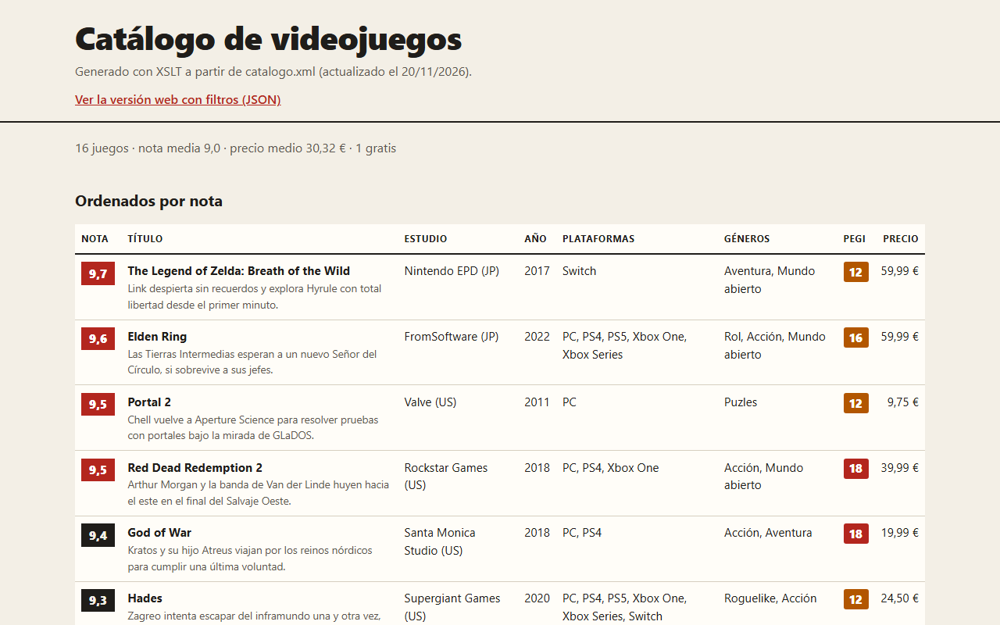

# Catálogo de videojuegos en XML

Práctica de Lenguajes de marcas (1º de DAW). Un catálogo de 16 videojuegos en XML que valido con una DTD y con un XSD, consulto con XPath y transformo con XSLT en una página HTML y en un JSON. Con ese JSON hice también una página con filtros en JavaScript.

Demo: https://michaelmarquez-daw.github.io/videojuegos-xml/web/

## Cómo se usa

Hace falta el JDK 21 (no hace falta Maven). Desde la carpeta del proyecto:

    java herramientas/Procesar.java

Valida `datos/catalogo.xml`, saca por consola las 10 consultas XPath y vuelve a generar `salida/catalogo.html` y `datos/catalogo.json`. Las consultas con su resultado están en `xpath/consultas-xpath.md`.

En `pruebas/` hay un XML con fallos puestos a propósito, que pasa la DTD pero no el XSD:

    java herramientas/Procesar.java pruebas/catalogo-con-errores.xml

Con ese fichero solo valida y consulta, no sobrescribe el HTML ni el JSON.

La página de `web/` lee el JSON con `fetch`, así que hay que abrirla con Live Server o cualquier servidor local, no con doble clic. Para comprobar el JSON con su schema, pega `datos/catalogo.schema.json` y `datos/catalogo.json` en https://www.jsonschemavalidator.net (draft 2020-12).

## Notas

- Uso DTD y XSD a la vez porque la DTD no sabe de tipos: le vale un precio con tres decimales o una plataforma inventada.
- Solo uso lo que trae el JDK, así que el XSLT es 1.0. Por eso la agrupación por PEGI va con `xsl:key` y para escapar comillas en el JSON hay una plantilla recursiva.
- El JSON lo genero con XSLT para que el XML sea la única fuente de datos. En el JSON Schema quité `multipleOf: 0.01` en los precios porque con decimales en coma flotante falla.
- `salida/catalogo.html` y `datos/catalogo.json` se generan, pero los subo para que la web funcione sin ejecutar nada antes.
